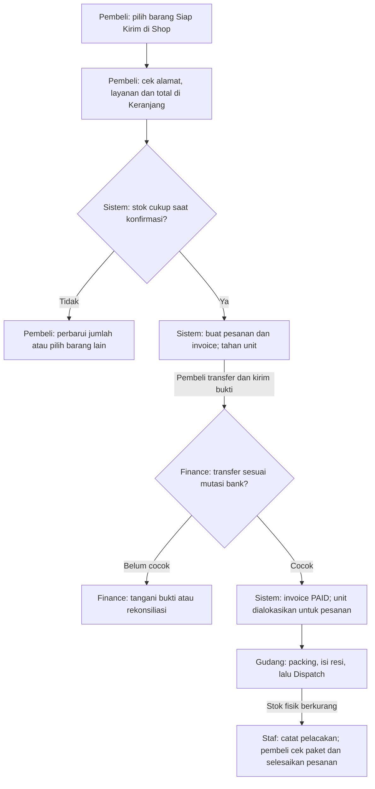
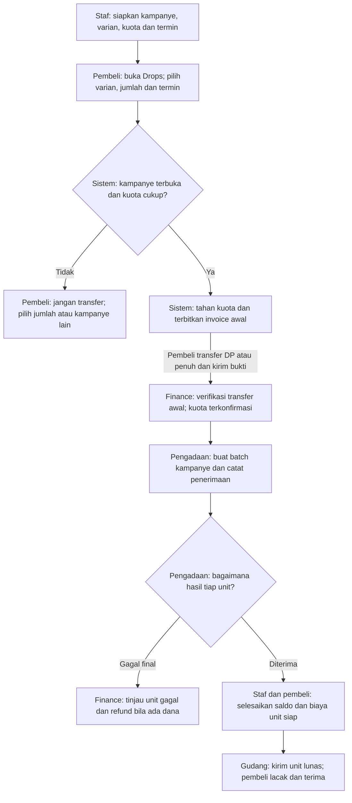
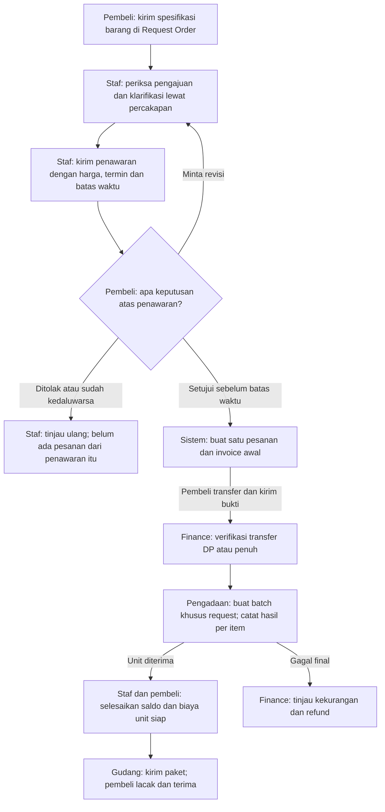

# Panduan operasional pembelian Snowe GO

Gunakan panduan ini untuk mengikuti satu transaksi dari layar pembeli sampai pengiriman atau pengembalian dana. Nama sebelum tanda titik dua di setiap kotak adalah pihak yang bertindak. **Pilih alur berdasarkan cara barang dijual, bukan cara membayarnya**: ketiganya dapat menggunakan transfer bank manual.

| Skema | Pembeli mulai dari | Yang diamankan saat pesanan dibuat | Setelah pembayaran awal diverifikasi |
|---|---|---|---|
| Ready Stock (Siap Kirim) | Shop → produk → Keranjang | Unit yang tersedia di gudang | Unit dialokasikan untuk dikirim. Stok fisik baru berkurang saat **Dispatch**. |
| Open Preorder | Drops → kampanye → Keranjang | Slot dari kuota varian kampanye, bukan stok gudang | Slot terkonfirmasi; DP belum berarti pesanan lunas. |
| Request Order | Request Order → Pengajuan baru | Pengajuan belum memesan apa pun. Pesanan dibuat saat pembeli menerima penawaran. | Barang bisa diproses untuk pengadaan khusus request tersebut. |

**Sebelum mulai.** Pembeli menggunakan akun terverifikasi dan alamat pengiriman miliknya. Staf masuk ke admin dengan MFA. Menu dan tombol mengikuti izin per aksi; izin melihat pesanan bukan izin menyetujui pembayaran. Pastikan rekening tujuan aktif dan pilih tarif/layanan yang tersedia untuk rute pengiriman.

## 1. Ready Stock: kirim barang yang sudah ada di gudang

1. **Pembeli — Shop → Keranjang.** Pilih varian dan jumlah, pilih alamat, tekan **Hitung tagihan & ongkir**, pilih layanan, lalu **Konfirmasi pesanan**. Menambah ke keranjang atau melihat estimasi belum menahan stok. Jika unit terakhir sudah diambil pembeli lain, jangan transfer: checkout yang gagal tidak menghasilkan invoice.
2. **Pembeli dan finance — Invoice → Pembayaran.** Bayar nominal invoice, termasuk ongkir RTS yang dipilih. Ikuti prosedur **Transfer manual** di bawah. Staf dapat memeriksa pesanan di **Commerce → Pesanan & RTS**, dan gudang dapat menelusuri unit di **Inventori → Reservasi**.
3. **Gudang — Pengiriman → Paket & Dispatch.** Rencanakan paket dari item pesanan, jalankan `PACK_START` → `PACK_FINISH` → `READY_FOR_DISPATCH`, masukkan resi, lalu **Dispatch**. Untuk kiriman parsial, hanya jumlah yang benar-benar dikirim mengurangi stok fisik. Catat perkembangan kurir di detail paket, bukan pada menu Tracking terpisah.

## 2. Open Preorder: amankan kuota, lalu adakan barang

1. **Staf — siapkan kampanye.** Tetapkan SKU, kuota, periode dan pilihan pembayaran (DP atau penuh sesuai kampanye). Pengelolaan kampanye tersedia melalui **API admin berizin**; belum ada halaman pengelolaan kampanye aktif di sidebar. Pembeli membuka **Drops** ketika kampanye `OPEN`.
2. **Pembeli — Drops → detail kampanye → Keranjang.** Pilih termin yang tersedia, periksa bagian **Bayar sekarang**, lalu konfirmasi. Jika dua orang mengincar slot terakhir, hanya satu checkout bisa menahannya. Bukti transfer belum menjadikan slot terkonfirmasi; verifikasi pembayaran awal memindahkan slot dari *ditahan* ke *terkonfirmasi*, bukan memotong kuota lagi. Jika hold kedaluwarsa tanpa pembayaran, slot dapat dilepas.
3. **Pengadaan — Commerce → Batch Pengadaan → Tambah Batch.** Setelah kampanye masuk tahap pengadaan dan pembayaran awal terkonfirmasi, pilih item dari kampanye yang sama. Gunakan **Catat tahap**, lalu **Catat penerimaan atau kekurangan** per item. Catat jumlah yang benar-benar diterima; tandai **jumlah gagal final** hanya jika unit itu tidak akan dipenuhi.
4. **Finance dan gudang — proses per unit.** Jika baru DP, gunakan **Commerce → Invoice** untuk menagih sisa unit yang sudah diterima dan belum ditagih. Untuk ongkir domestik, buat paket dan ambil **Quote ongkir PO/RO** di **Pengiriman → Paket & Dispatch**; ajukan biayanya dari detail invoice. Pembeli membuka detail pesanan, memilih **Setujui biaya** atau **Tolak**; hanya biaya yang disetujui menjadi invoice. Kirim unit siap setelah semua kewajiban unit dan paket tersebut lunas. Unit lain boleh menyusul.

## 3. Request Order: sepakati penawaran sebelum memesan

1. **Pembeli — Request Order → Pengajuan baru.** Isi judul, deskripsi, nama barang dan jumlah. Tambahkan varian, tautan sumber, anggaran atau target tanggal jika ada, lalu **Kirim pengajuan**. Simpan nomor request untuk percakapan; nomor ini belum menjadi instruksi transfer.
2. **Staf — Commerce → Request Order → detail.** Jika spesifikasi belum jelas, pilih **Minta informasi** dan tulis pertanyaannya melalui **Balas pelanggan**. **Catatan internal** tidak terlihat oleh pembeli. Jika bisa dipenuhi, siapkan dan kirim **Penawaran harga** dengan rincian item, termin, estimasi ongkir dan masa berlaku.
3. **Pembeli — detail Request Order → Penawaran.** Pilih **Minta revisi**, **Tolak**, atau pilih alamat dan **Setujui & pesan**. Item dan harga penawaran yang sudah dikirim tidak berubah. Jika ada revisi, periksa versi terbaru; versi lama atau kedaluwarsa tidak bisa diterima. Klik ganda atau persetujuan bersamaan tidak membuat dua pesanan: cek hasilnya di **Pesanan**, tanpa checkout lagi. **Estimasi ongkir bukan tagihan.** Buka invoice awal untuk membayar harga barang atau DP.
4. **Pengadaan dan gudang — setelah pembayaran awal terverifikasi.** Buat batch untuk **satu request**, bukan batch kampanye. Catat penerimaan per item. Untuk unit diterima, proses sisa harga jika ada, usulkan ongkir/biaya tambahan, minta persetujuan pembeli dan verifikasi pembayaran sebelum dispatch. Untuk kekurangan final, finance menilai refund sesuai dana yang dibayar atas unit tersebut.

## Transfer manual: bukti unggahan bukan bukti pelunasan

| Urutan | Siapa dan di mana | Apa yang dilakukan |
|---|---|---|
| 1 | Pembeli · Pesanan → detail → Invoice | Pilih bank dan **Dapatkan instruksi transfer**. Bayar ke rekening, sebesar nominal, dan sebelum tenggat yang tampil. |
| 2 | Pembeli · Pembayaran transfer | Unggah bukti privat. Setelah pemindaian menyatakan berkas siap (`READY`), tekan **Kirim bukti yang sudah diperiksa**. Pembayaran menunggu verifikasi finance. |
| 3 | Finance · Finance → Pembayaran → detail | Pilih **Ambil review**, cocokkan rekening, nominal dan referensi dengan mutasi bank. Jika cocok, masukkan referensi dan jumlah lalu **Setujui pembayaran**. Jangan menyetujui hanya dari gambar bukti. |
| 4 | Finance · jika ada selisih | Jika bukti tidak sah, tolak dengan alasan. Jika uang benar-benar masuk tetapi terlambat, ganda atau salah nominal, gunakan **Finance → Rekonsiliasi**. Pemeriksa kedua menyetujui kasus; petugas yang berbeda dari pemeriksa dapat menerapkan dana hanya jika tagihan dan stok/kuota masih layak, atau mencatat transfer balik beserta buktinya. |

## Setelah dikirim: selesai, retur, atau refund?

| Situasi | Tindakan berikutnya |
|---|---|
| Pesanan belum dibayar dan pembeli berubah pikiran | Di detail pesanan, pilih **Batalkan pesanan** dan alasan jika masih memenuhi syarat. Pembatalan atau kedaluwarsa melepaskan reservasi stok/kuota yang masih ditahan; jika uang sudah ditransfer, laporkan ke finance sebelum mencoba membayar lagi. |
| Paket dalam perjalanan atau gagal antar | Di **Pengiriman → Paket & Dispatch**, staf membuka paket dan memilih **Catat pelacakan**. Pembeli melihat riwayat dari **Pesanan → Lacak paket**. Gagal antar bukan bukti barang sudah kembali ke gudang. |
| Semua unit yang wajib dikirim sudah diterima | Pembeli memilih **Selesaikan pesanan** di detail pesanan jika semua kewajiban sudah selesai dan tidak ada sengketa terbuka. Jangan menutup pesanan hanya karena satu paket sudah tiba. |
| Barang sudah diterima tetapi bermasalah | Pembeli membuka **Lacak paket → Ajukan retur** dalam jendela retur, memilih unit dan alasan, lalu mengirim klaim. Di detail retur, unggah minimal dua foto berbeda; masukkan resi balik jika diminta. Staf menindaklanjuti di **Commerce → Return**. Hasil inspeksi menentukan penolakan, pengiriman barang pengganti/kurang, perbaikan atau refund. |
| Dana sudah tercatat, tetapi barang tidak dapat dipenuhi | Untuk kekurangan pemasok, buka **Finance → Refund**, periksa baris kekurangan dan pilih **Ajukan refund item** jika layak. Pembeli juga bisa mengajukan refund dari detail pesanan jika masih ada saldo yang dapat dikembalikan. Pemeriksa menyetujui nominal; petugas berbeda mentransfer manual dan mencatat referensi serta bukti. Batasnya pembayaran yang benar-benar diterima untuk unit terkait; bila baru DP, bukan harga penuh. |
| Pembeli sudah transfer setelah reservasi lepas dan slot terakhir sudah diambil | Jangan merebut slot pembeli lain atau memaksa status `PAID`. Jika transfer belum diterapkan ke invoice dan kuota tidak bisa dipulihkan, gunakan **Rekonsiliasi → Catat transfer balik**, bukan Refund atas penjualan. |

**Referensi:** [Aturan transaksi dan status](06-BUSINESS-FLOWS.md) · [Matriks menu dan izin](07-ADMIN-MENU-MATRIX.md) · [Aktivasi layanan](10-DEPLOYMENT.md).
