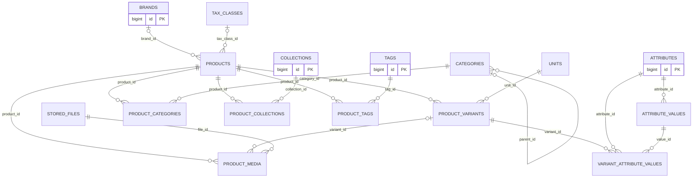
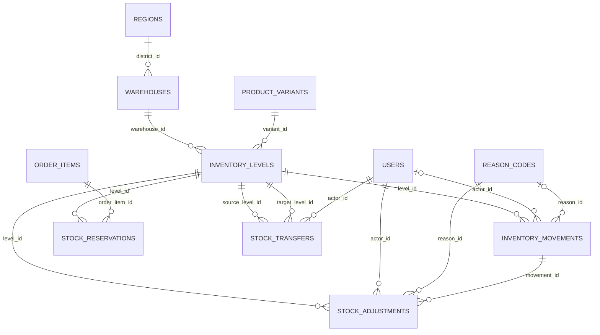
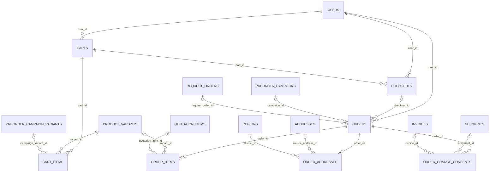
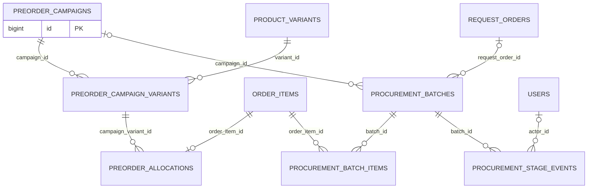
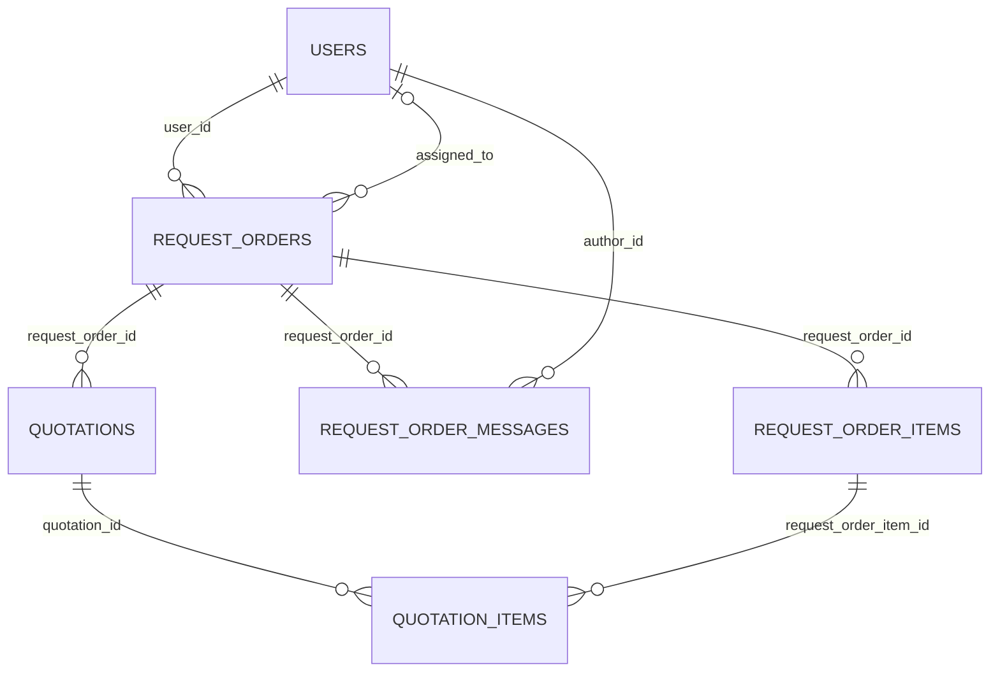
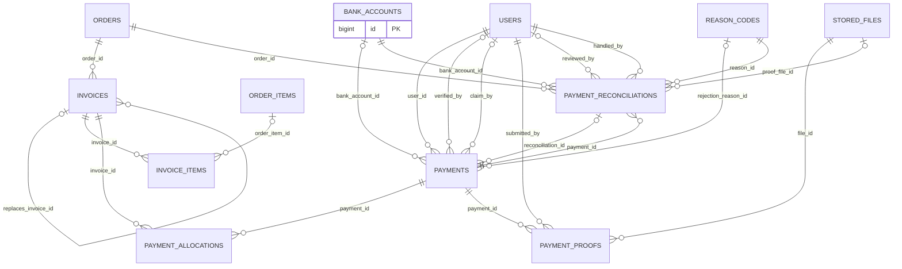
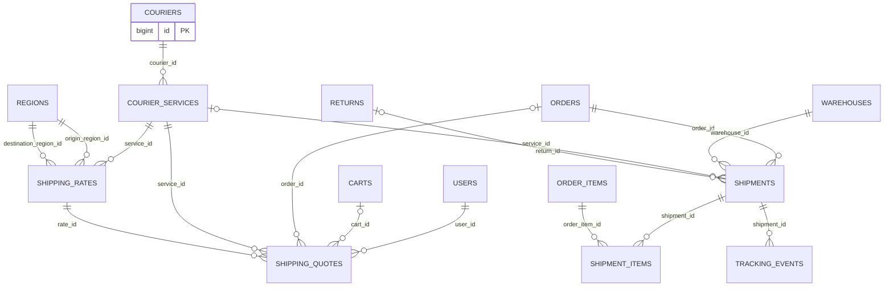
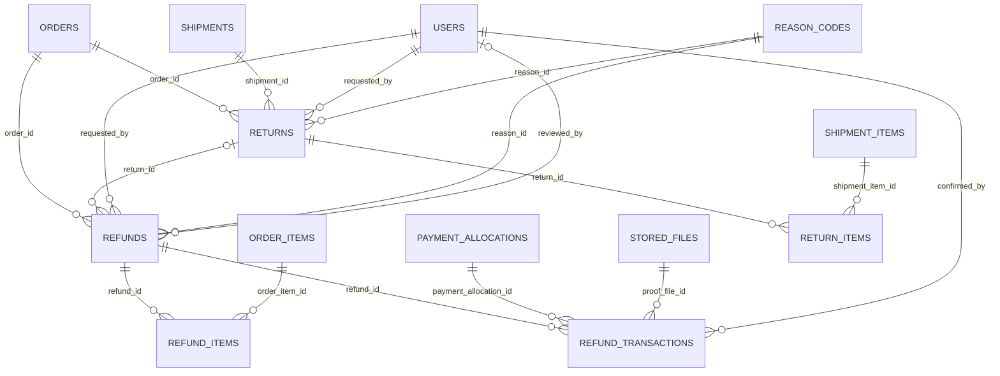
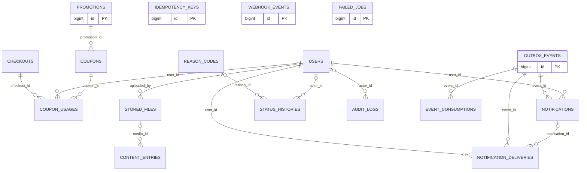

# Entity relationship diagrams

Relasi mayoritas mengikuti foreign key. Partial unique dan relasi polimorfik dirinci di [kamus data](../04-DATABASE-SCHEMA.md). Nama tabel uppercase di diagram untuk keterbacaan.

## Identity

```mermaid
erDiagram
    USERS ||--o{ STAFF_INVITATIONS : "user_id"
    USERS {
        bigint id PK
    }
    USERS ||--o{ SOCIAL_ACCOUNTS : "user_id"
    USERS o|--o{ SESSIONS : "user_id"
    PASSWORD_RESET_TOKENS {
        bigint id PK
    }
    USERS ||--o{ OAUTH_LINK_REQUESTS : "user_id"
    USERS ||--o| CUSTOMER_PROFILES : "user_id"
    USERS ||--o{ ADDRESSES : "user_id"
    REGIONS ||--o{ ADDRESSES : "district_id"
    USERS ||--o{ WISHLISTS : "user_id"
    PRODUCTS ||--o{ WISHLISTS : "product_id"
    REGIONS o|--o{ REGIONS : "parent_id"
    REASON_CODES {
        bigint id PK
    }
    UNITS {
        bigint id PK
    }
    TAX_CLASSES {
        bigint id PK
    }
    ROLES {
        bigint id PK
    }
    PERMISSIONS {
        bigint id PK
    }
    ROLES ||--o{ MODEL_HAS_ROLES : "role_id"
    PERMISSIONS ||--o{ MODEL_HAS_PERMISSIONS : "permission_id"
    ROLES ||--o{ ROLE_HAS_PERMISSIONS : "role_id"
    PERMISSIONS ||--o{ ROLE_HAS_PERMISSIONS : "permission_id"
    USERS o|--o{ SETTINGS : "updated_by"
    INTEGRATION_CONFIGS {
        bigint id PK
    }
```

## Catalog

## Inventory

## Commerce

## Preorder

## Request order

## Payment dan invoicing

## Shipping

## Refund dan return

## Platform, content, promo dan notifikasi

